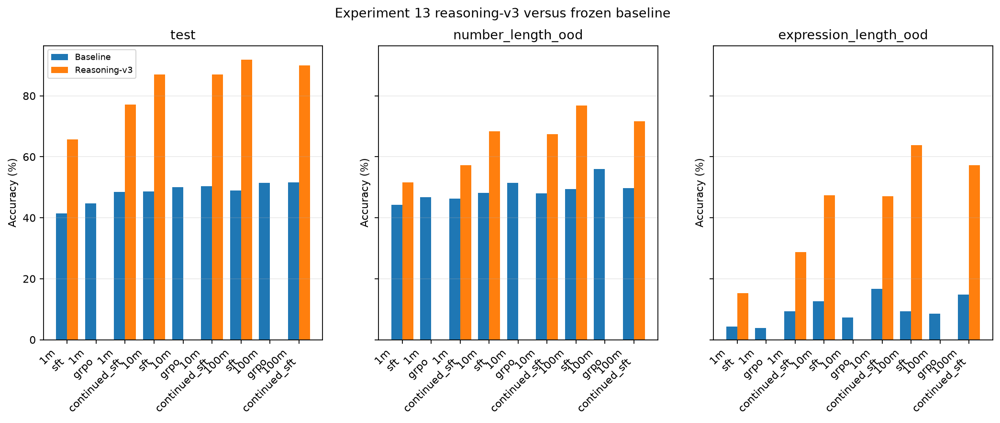

# TinyMath-RL

**Small language models. Character-level mathematics. Verifiable rewards.**

TinyMath-RL studies how mathematical accuracy and generalization change with
model size and training method. It trains decoder-only Transformers from scratch
at approximately **1M, 10M, and 100M parameters**, then compares supervised
fine-tuning (SFT), reinforcement learning with verifiable rewards (RLVR) using
Group Relative Policy Optimization (GRPO), and continued SFT.

[Results](#results) · [Quick start](#quick-start) · [Research protocol](#research-protocol) · [Documentation](#documentation)

## Results

### Experiment 13 · Reasoning-v3

The 100M reasoning-v3 SFT model reaches **91.88% test accuracy** and **63.90%
expression-length out-of-distribution (OOD) accuracy**, compared with 48.88%
and 9.35% for its frozen baseline. These are results for **one seed (18)**.

Reasoning-v3 adds structured scratchpads and arithmetic subtask examples.
Its runtime supports optional arithmetic calls; see the
[execution protocol](docs/REASONING_V3.md) for tool eligibility and scoring.

[](docs/assets/exp13-accuracy-comparison.svg)

*Blue: frozen baseline. Orange: reasoning-v3. Missing orange GRPO bars indicate
unavailable evaluations. [View the vector figure](docs/assets/exp13-accuracy-comparison.svg).*

Reasoning-v3 accuracy, with gains over the matching frozen baseline in parentheses:

| Model | Split | SFT accuracy (Δ pp) | Continued-SFT accuracy (Δ pp) |
|---|---|---:|---:|
| 1M | Test | 65.76% (+24.29) | 77.17% (+28.63) |
| 1M | Number-length OOD | 51.60% (+7.34) | 57.18% (+10.82) |
| 1M | Expression-length OOD | 15.25% (+10.95) | 28.70% (+19.40) |
| 10M | Test | 86.98% (+38.37) | 86.97% (+36.66) |
| 10M | Number-length OOD | 68.34% (+20.20) | 67.48% (+19.44) |
| 10M | Expression-length OOD | 47.35% (+34.70) | 47.05% (+30.30) |
| 100M | Test | 91.88% (+43.00) | 89.92% (+38.35) |
| 100M | Number-length OOD | 76.88% (+27.52) | 71.60% (+21.90) |
| 100M | Expression-length OOD | 63.90% (+54.55) | 57.25% (+42.40) |

**Reading the results.** Accuracy measures final-answer correctness. Each delta
is a percentage-point change from the frozen baseline for the same model, arm,
and split. Evaluations match parent-question identities across conditions:
50,000 test questions, 5,000 number-length OOD questions, and 2,000
expression-length OOD questions. Added standalone subtasks are excluded from
these scores.

**Current limitations.** Reasoning-v3 GRPO evaluations are unavailable in this
snapshot, and the GRPO/continued-SFT compute comparison is still pending.
The reported deltas compare complete protocols; they do not isolate the effect
of scratchpads, subtask augmentation, or tool execution. One seed provides no
estimate of variation across seeds.

<details>
<summary>Result provenance and annotation audit</summary>

The table and figure summarize the local Experiment 13 report at
`reports/exp13_reasoning_v3_arithmetic_subtasks/seed18/`. Its `comparison.json`
and `comparison.csv` record checkpoint hashes, question identities, module
metrics, generation diagnostics, and W&B run metadata.

- Baseline: `restarted_100k_greedy_restart_2`, frozen on October 14, 2026.
- Bundle manifest SHA256: `5d493a0f4c961b84b873036ea1bc93ebb6d01b6f022d7ed81997b094da3a018f`.
- Annotation audit: 1,096,065 rows checked, with zero invalid traces.
- Actual model sizes: 995,456; 9,989,760; and 99,177,216 parameters.
- [Report configuration](configs/experiment/13_reasoning_v3_arithmetic_subtasks_report_r69.yaml).

The small PNG/SVG figures above are versioned documentation assets. Full run
artifacts and generated reports remain local and are excluded from Git.

</details>

## Quick start

Use **Python 3.11+** and **uv**. The project targets a single **NVIDIA RTX 4090
with 24 GB VRAM**. The commands below assume the checkout is mounted at
`/workspace` in an environment with compatible CUDA/PyTorch support.

### 1. Install and configure tracking

```bash
cd /workspace
uv sync --locked
export WANDB_ENTITY=your-wandb-entity
```

All experiments use W&B. Supply `WANDB_API_KEY` through the environment or an
ignored `/workspace/.env` file; the tracking helper reads it at runtime. Set
`WANDB_ENTITY` to your own account or team. Credentials must stay out of Hydra
overrides and version control.

### 2. Prepare data and train a pilot

Use the same experiment preset and seed for data preparation and training:

```bash
uv run python scripts/prepare_data.py experiment=02_pilot seed=17
uv run python scripts/train_sft.py model=1m trainer=sft experiment=02_pilot seed=17
```

The pilot uses a 20,000-example SFT budget. Data preparation scans the selected
source modules before constructing the disjoint pools, so a small training
budget does not imply a small download. For the data-only smoke workflow, use
`uv run python scripts/run_all.py experiment=01_smoke`.

### 3. Explore examples or run the full comparison

Browse prepared bundles, module counts, and annotated examples:

```bash
uv run streamlit run scripts/browse_data.py
```

Run the three-size workflow, including data preparation, SFT, GRPO, continued
SFT, evaluation, and reporting:

```bash
uv run python scripts/run_all.py experiment=03_main seed=17
```

Experiment entry points use Hydra. Override model, training, and tracking
settings directly:

```bash
uv run python scripts/train_sft.py model=10m trainer=sft experiment=02_pilot \
  seed=17 tracking.project=tinymath-rl tracking.group=pilot-seed17 \
  tracking.name=pilot-10m-seed17 tracking.mode=online
```

See the [usage guide](docs/USAGE.md) for evaluation, checkpoint resume, explicit
bundle selection, and W&B synchronization. If connectivity requires offline
tracking, select `tracking.mode=offline` explicitly; those runs remain unsynced
until uploaded.

## Research protocol

The data pipeline uses the DeepMind Mathematics Dataset, pinned to a source
revision in the [data configuration](configs/data/default.yaml), and is restricted
to five modules:

| Task | Module |
|---|---|
| Addition and subtraction | `arithmetic__add_or_sub` |
| Multiplication | `arithmetic__mul` |
| Division | `arithmetic__div` |
| Mixed arithmetic | `arithmetic__mixed` |
| Linear equations | `algebra__linear_1d` |

Models use causal attention, RoPE, RMSNorm, and SwiGLU. A frozen character
vocabulary maps each ordinary Unicode code point to exactly one token,
including digits, spaces, operators, and reasoning delimiters. SFT loss covers
completion tokens and EOS. SFT, validation, RLVR, and evaluation pools are kept
disjoint through deterministic splitting and question deduplication.

The main evaluation uses greedy decoding and reports final-answer accuracy by
module, alongside format validity and separate number-length and
expression-length out-of-distribution (OOD) tests. Where official extrapolation
rows are unavailable, controlled held-out pools are constructed and documented
in the split manifest; see the [data protocol note](docs/USAGE.md#data-and-ood-protocol-note).

Dependencies are pinned in `uv.lock`; Hydra composes experiment settings; W&B
records metrics and provenance. Runs save sanitized resolved configurations,
seeds, dataset/tokenizer hashes, and resumable checkpoints.

## Documentation

| Guide | Contents |
|---|---|
| [Usage](docs/USAGE.md) | Environment setup, data preparation, training, evaluation, resume, and tracking |
| [Experiments](docs/EXPERIMENT_GUIDE.md) | Experiment presets, comparison workflow, and validation commands |
| [Reasoning-v3](docs/REASONING_V3.md) | Scratchpad format, arithmetic execution, rewards, and token accounting |

Source lives in `src/tinymath/`, entry points in `scripts/`, and composed
configurations in `configs/`. Run the regression suite with `uv run pytest -q`.
Datasets, weights, checkpoints, local run outputs, W&B state, and credentials
are excluded from Git.
