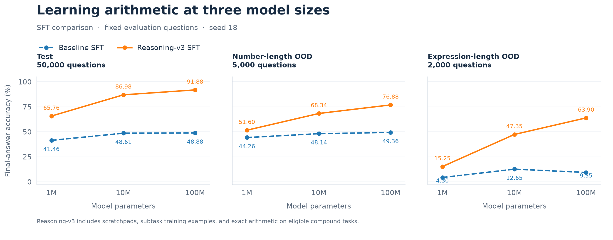
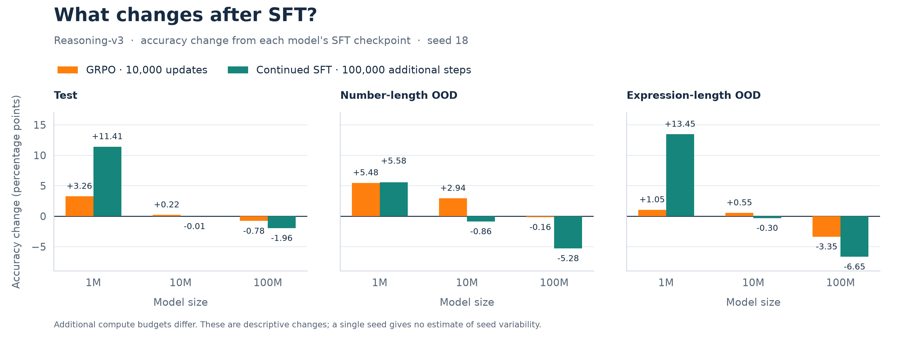
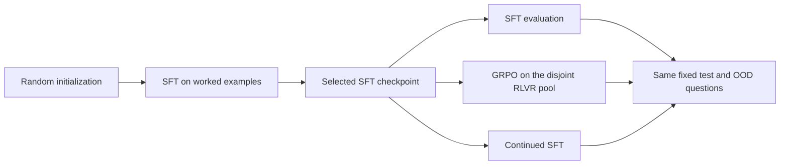

# TinyMath-RL

**Small models. Character-level mathematics. Verifiable learning.**

TinyMath-RL explores how much arithmetic a small language model can learn—and
whether reinforcement learning helps it generalize. It trains decoder-only
Transformers from scratch at **1M, 10M, and 100M parameters**, then compares
supervised fine-tuning (SFT), Group Relative Policy Optimization (GRPO), and
continued SFT on the same fixed math questions.

The setting is deliberately small and inspectable: five tasks from the
[DeepMind Mathematics Dataset](https://huggingface.co/datasets/d0rj/mathematics_dataset),
one Unicode character per token, exact answer verification,
and experiments designed for a **single RTX 4090 with 24 GB VRAM**. The
reasoning-v3 protocol adds structured scratchpads, arithmetic subtask examples,
and optional exact arithmetic calls on eligible compound tasks.

[Results](#results) · [How it works](#how-it-works) · [Quick start](#quick-start) · [Reproducibility](#reproducibility) · [Outlook](#outlook)

## Results

The completed comparison covers all three model sizes and training arms at
**seed 18**, using 50,000 test questions, 5,000 number-length OOD questions, and
2,000 expression-length OOD questions. OOD means out of distribution; these
held-out tests select questions by number width or expression length using fixed
difficulty thresholds.

The **100M SFT model reaches 91.88% test accuracy and 63.90% expression-length
OOD accuracy**. The corresponding baseline SFT model scores 48.88% and 9.35%.
That is a **54.55 percentage-point gain** on expression-length OOD for the full
reasoning-v3 protocol.

[](docs/assets/reasoning-v3-scaling.svg)

*Blue: baseline SFT. Orange: reasoning-v3 SFT. Model size uses a logarithmic
axis. [Open the vector figure](docs/assets/reasoning-v3-scaling.svg).*

### Existing reasoning-v3 results

Final-answer accuracy; **bold** marks the best training arm within each row.
Continued SFT and GRPO start from the same SFT checkpoint for each model size.
The continued-SFT column below is the historical, unequal-budget run; matched
continued-SFT controls have not yet completed.

| Model | Evaluation split | SFT | GRPO | Continued SFT |
|:---|:---|---:|---:|---:|
| 1M | Test | 65.76% | 69.02% | **77.17%** |
| 1M | Number-length OOD | 51.60% | 57.08% | **57.18%** |
| 1M | Expression-length OOD | 15.25% | 16.30% | **28.70%** |
| 10M | Test | 86.98% | **87.20%** | 86.97% |
| 10M | Number-length OOD | 68.34% | **71.28%** | 67.48% |
| 10M | Expression-length OOD | 47.35% | **47.90%** | 47.05% |
| 100M | Test | **91.88%** | 91.10% | 89.92% |
| 100M | Number-length OOD | **76.88%** | 76.72% | 71.60% |
| 100M | Expression-length OOD | **63.90%** | 60.55% | 57.25% |

**Additional training has different effects at different sizes.** Continued SFT
leads at 1M, including a 13.45-point improvement over SFT on expression-length
OOD. GRPO leads on all three splits at 10M, although its test gain over SFT is
only 0.22 points. At 100M, SFT remains strongest on every split; neither
additional training arm improves its accuracy in this run.

[](docs/assets/reasoning-v3-training-gains.svg)

*Each bar is a change from that model's reasoning-v3 SFT accuracy; zero means
no change. [Open the vector figure](docs/assets/reasoning-v3-training-gains.svg).*

### What these measurements support

These are **single-seed, descriptive results**. The baseline-to-reasoning-v3
comparison changes the training representation, adds subtask examples, and
permits arithmetic assistance on eligible tasks. It does not isolate which
component causes the gains, and assisted accuracy should be read with that
protocol in mind. Final-answer correctness also does not establish the validity
of every intermediate reasoning step.

The additional training budgets are **unequal**: GRPO runs for 10,000 updates;
the historical continued-SFT runs run for 100,000 updates. Recomputing their
run-only dense FLOPs from padded positions (without subtracting source-SFT work
a second time) gives approximately **5.03×, 6.48×, and 7.26×** the GRPO compute
at 1M, 10M, and 100M, respectively. A new comparison will replace this column
only after the GRPO-matched controls are trained and evaluated. See the
[matched-compute plan](docs/compute-matched-continued-sft-plan.md) for budgets,
stopping criteria, GPU admission limits, and the reporting protocol.

The selected source modules lacked eligible official extrapolation rows at the
pinned dataset revision. The OOD tests therefore use deterministic held-out
pools with documented difficulty thresholds. See the
[data and OOD protocol](docs/USAGE.md#data-and-ood-protocol-note).

All displayed values and figure inputs are available in the versioned
[result snapshot](docs/results/reasoning-v3-seed18.json), including checkpoint
hashes, evaluation run IDs, and question-population hashes. The figures combine
verified existing SFT/continued-SFT evaluations with the completed GRPO
evaluations; comparison arms were reused without retraining.

## How it works

### Five tasks, one character vocabulary

The dataset is restricted to these five modules:

| Task | DeepMind Mathematics module |
|:---|:---|
| Addition and subtraction | `arithmetic__add_or_sub` |
| Multiplication | `arithmetic__mul` |
| Division | `arithmetic__div` |
| Mixed arithmetic | `arithmetic__mixed` |
| Linear equations | `algebra__linear_1d` |

Every ordinary Unicode code point—including each digit, space, operator, and
reasoning delimiter—maps to exactly one token. The vocabulary is frozen across
model sizes and training arms. The models use causal attention, RoPE, RMSNorm,
SwiGLU, and tied embeddings. Their actual sizes with the reasoning-v3 vocabulary
are **995,456**, **9,989,760**, and **99,177,216** trainable parameters.

Data preparation deduplicates questions and creates disjoint SFT, validation,
RLVR, and evaluation pools. The reasoning-v3 bundle contains 500,000 SFT parent
questions plus generated arithmetic subtasks. Evaluation scores parent questions
only, so standalone subtasks do not inflate reported accuracy.

### Three training arms



**SFT** optimizes completion and EOS tokens; prompt and padding tokens are
excluded from the loss. Both additional training arms initialize from the
selected SFT checkpoint.

**GRPO** samples 16 completions for each of 16 prompts per update, scores them
with a deterministic verifier, and learns from reward differences within each
prompt's group. The completed runs use temperature 1.0, 10,000 updates, and a
512-token completion ceiling, further bounded by the remaining model context.
Groups with identical rewards have zero relative advantage.

Reasoning-v3 uses the shaped reward
`0.1 × format_valid + 0.9 × full_success`, with hard-zero conditions for malformed,
capped, executor-failed, or forbidden-call rollouts. Exact arithmetic calls are
permitted for eligible compound tasks; atomic tasks must solve their operation
locally. The executor inserts arithmetic results without executing generated
code. Inserted tokens provide context but are excluded from the policy loss.
The [reasoning-v3 guide](docs/REASONING_V3.md) specifies the full protocol.

## Quick start

Use **Python 3.11+**, **uv**, and a CUDA-compatible PyTorch environment. Commands
below assume the checkout is mounted at `/workspace`.

### Install

```bash
cd /workspace
uv sync --locked
export WANDB_ENTITY=your-wandb-entity
```

Experiment runs use W&B. Supply `WANDB_API_KEY` through the environment or an
ignored `/workspace/.env` file; experiment entry points load it at runtime.
Keep credentials out of Hydra overrides and version control. Documentation,
figure rendering, and tests need no W&B connection.

### Run a 1M pilot

```bash
uv run --locked python scripts/prepare_data.py experiment=02_pilot seed=17
uv run --locked python scripts/train_sft.py \
  experiment=02_pilot model=1m trainer=sft seed=17
```

The pilot uses 20,000 SFT examples. Preparation scans the selected source modules
before building the pools, so a small training budget still requires the source
data download. To run SFT, GRPO, continued SFT, evaluation, and reporting for one
model through the orchestrator:

```bash
uv run --locked python scripts/run_all.py \
  experiment=02_pilot seed=17 'orchestration.models=[1m]'
```

These pilot commands exercise the default answer-only protocol. The published
results above use the separate reasoning-v3 bundle and training presets.

### Inspect configurations and data

Hydra composes every experiment configuration. Inspect effective values without
starting a run:

```bash
uv run --locked python scripts/train_rlvr.py \
  experiment=15_reasoning_v3_arithmetic_subtasks model=1m --cfg job --resolve
```

The completed comparison is defined by the
[Experiment 15 preset](configs/experiment/15_reasoning_v3_arithmetic_subtasks.yaml).
It references local data and checkpoints from earlier stages; a fresh checkout
must prepare those artifacts before training or evaluation. The preset records
their expected hashes and provenance.

Browse prepared data locally:

```bash
uv run --locked streamlit run scripts/browse_data.py
```

See the [usage guide](docs/USAGE.md) for bundle preparation, training, checkpoint
resume, evaluation, and explicit offline tracking when needed.

## Reproducibility

Dependencies are locked in `uv.lock`. Runs persist sanitized resolved Hydra
configurations, seeds, dataset and tokenizer hashes, checkpoint lineage, and
W&B identities. Resumable checkpoints preserve optimizer and RNG state;
checkpoint selection uses validation rather than test accuracy. Main evaluation
uses greedy decoding and records the output cap and context limit.

| Location | Contents |
|:---|:---|
| `src/tinymath/` | Data pipeline, models, training, verification, evaluation, and tracking |
| `configs/` | Model families, training settings, and composed experiment presets |
| `scripts/` | Experiment entry points and local data browser |
| `tests/` | Tokenization, leakage, loss masks, verification, GRPO, and integration checks |
| `docs/results/` | Small versioned result snapshots used by documentation figures |
| `runs/`, `reports/`, `outputs/` | Local checkpoints, full reports, metrics, and Hydra outputs; excluded from Git |

The completed local report is under
`reports/exp15_reasoning_v3_arithmetic_subtasks/seed18/`: `comparison.json` and
`comparison.csv` hold the detailed measurements, `intermediate_results.md` holds
the written comparison, and `accuracy_comparison.svg` shows all arms. These
generated artifacts and the model weights are not bundled with the repository.

The README figures can be regenerated from the checked-in snapshot alone:

```bash
uv run --locked python docs/render_results.py
```

Run the regression suite locally:

```bash
uv run --locked pytest -q
```

## Outlook

The next experiments should explain why additional training helps some model
sizes and reduces accuracy at others:

- **Repeat across seeds.** Measure variation before interpreting the small 10M
  GRPO gains as a consistent advantage.
- **Match additional compute.** Compare GRPO and continued SFT at common token
  or FLOP budgets, with accuracy-versus-compute curves.
- **Separate the ingredients.** Ablate scratchpads, subtask augmentation, and
  arithmetic assistance while holding evaluation questions fixed.
- **Study the learning signal.** Relate mixed-reward group frequency, entropy,
  and format validity to learning progress and possible saturation.
- **Map generalization failures.** Break down errors by module, operand width,
  and expression depth, then evaluate on independently generated OOD sets.

## Further reading

| Guide | What it covers |
|:---|:---|
| [Usage](docs/USAGE.md) | Setup, data preparation, training, evaluation, resume, and tracking |
| [Experiment guide](docs/EXPERIMENT_GUIDE.md) | Experiment presets and comparison workflows |
| [Reasoning-v3 protocol](docs/REASONING_V3.md) | Scratchpads, arithmetic execution, rewards, and token accounting |
| [Implementation plan](IMPLEMENTATION_PLAN.md) | Scientific scope and engineering requirements |
| [Result snapshot](docs/results/reasoning-v3-seed18.json) | Exact values and provenance behind the README plots |
